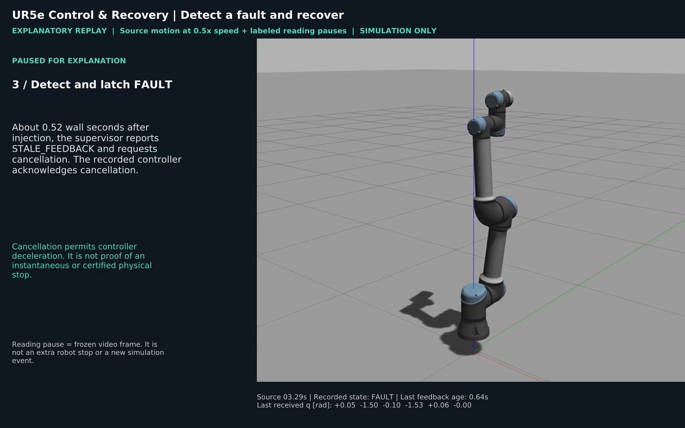
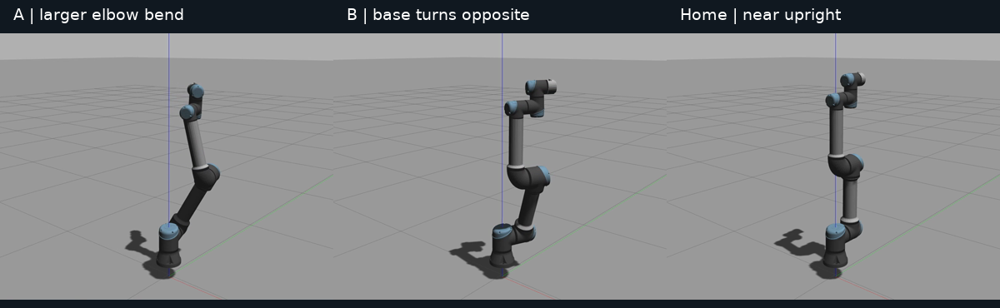
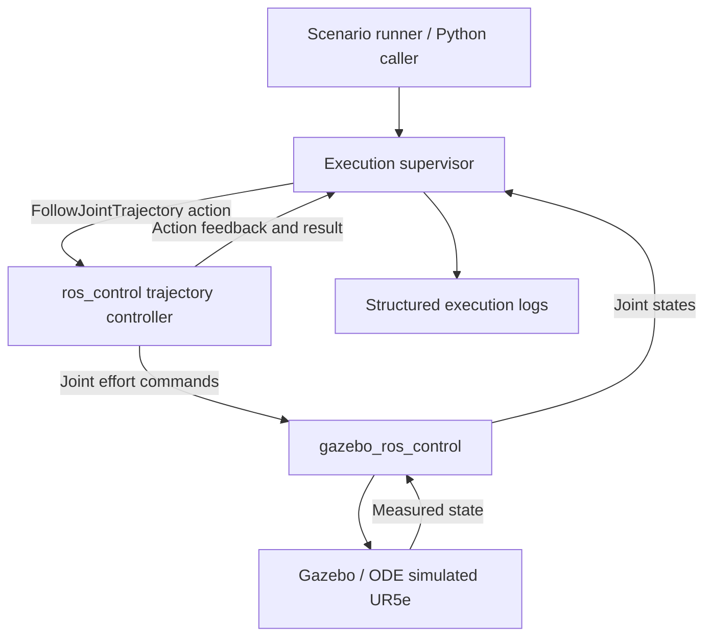

# UR5e Control & Recovery

**Robot control, execution monitoring, and fault recovery with ROS 1 and Gazebo.**

A simulation-only robotics integration capstone built around a UR5e arm. Commands
travel through an existing ROS trajectory controller into Gazebo physics, and
completion is checked against measured robot state. The project demonstrates
asynchronous execution, command replacement, failure detection, explicit recovery,
and reproducible integration tests.

**Verified:** 8 integration tests passing · Headless and graphical simulation · No physical hardware or paid services

## Understand the demonstrations

**Start with the [explained walkthrough — about 3 minutes](artifacts/demo-clips/00-explained-demo.mp4).**
It introduces each scenario, plays the recorded motion at **0.5× speed**, and pauses
at the decisions that were too quick to follow in the original clips. A side panel
explains the current command, software decision, and expected outcome.

[](artifacts/demo-clips/00-explained-demo.mp4)

| Explained clip | Question it answers | Length |
| --- | --- | --- |
| [1. Verified robot motion](artifacts/demo-clips/01-verified-motion-explained.mp4) | Did the robot actually reach the requested joint configuration? | 68 s |
| [2. Command replacement](artifacts/demo-clips/02-command-replacement-explained.mp4) | What happens when B arrives while A is still executing? | 47 s |
| [3. Fault detection and recovery](artifacts/demo-clips/03-fault-and-recovery-explained.mp4) | What happens when feedback disappears, and what permits motion again? | 76 s |

**How to read the replay:** “PAUSED FOR EXPLANATION” means an editorial freeze so you
can read; it is not an additional robot stop. The footer shows the **source recording
clock**, recorded supervisor state, and age of the last feedback sample. These values
freeze during a reading pause. The timelines below use that source clock, so they also
match the [original 44-second, real-time recording](artifacts/demo-clips/00-full-demo.mp4).
The explained videos are edited replays of the same executions, not new test runs.
All clips are silent and captioned.

### The targets: what are A, B, and home?



A and B are **six joint angles**, not task names. The program specifies angles in
radians, in this order: shoulder pan, shoulder lift, elbow, wrist 1, wrist 2, wrist 3.
The existing controller moves the joints between configurations; this demo does not
ask the robot to grasp an object or plan a Cartesian path.

| Configuration | Six commanded joint angles, in radians | What changes visibly |
| --- | --- | --- |
| A | `[+0.35, -1.08, -0.72, -1.30, +0.45, 0.00]` | Bend the elbow, turn the base in the positive direction, and change wrist orientation |
| B | `[-0.40, -1.22, -0.35, -1.65, -0.30, +0.20]` | Turn the base in the opposite direction, reduce the elbow bend, and reorient the wrist |
| Home | `[0.00, -1.57, 0.00, -1.57, 0.00, 0.00]` | Return to the near-upright configuration |

### 1. Verified robot motion — command, execute, measure

**[Watch the explained motion clip](artifacts/demo-clips/01-verified-motion-explained.mp4)** · [Original footage](artifacts/demo-clips/01-verified-motion.mp4)

**Purpose:** show that a requested motion actually happened. A successful action
response alone is insufficient evidence.

1. Starting from a near-upright pose, Python sends A through the existing
   `FollowJointTrajectory` action, with a four-second duration in simulation time.
2. The controller interpolates the trajectory and applies joint efforts through
   `gazebo_ros_control`. Gazebo advances the robot's physics.
3. After the controller reports success, the supervisor also requires fresh measured
   joint positions within **0.03 rad**, speed below **0.05 rad/s**, and **0.25 simulated
   seconds** of settling. Only then does its Future return `SUCCEEDED`.
4. The program repeats this process for B, then home. The changing elbow bend and
   base/wrist orientation are the motion to watch.

| Source time | What happens |
| --- | --- |
| 0.8 s | Send A; the arm starts moving |
| 5.8 s | A passes measured completion checks |
| 7.4 s | Send B |
| 12.4 s | B passes; send home |
| 17.4 s | Home passes; all three moves are complete |

**Recorded result:** all three moves returned `SUCCEEDED / MEASURED_TARGET_REACHED`.
Maximum joint error at the recorded terminal observations was about **0.00218 rad
for A**, **0.00143 rad for B**, and **0.000024 rad for home**. These are the larger
filmed motions; the separate baseline test has its own measurements below.

### 2. Command replacement — interrupt A and complete B

**[Watch the explained replacement clip](artifacts/demo-clips/02-command-replacement-explained.mp4)** · [Original footage](artifacts/demo-clips/02-command-replacement.mp4)

**Purpose:** show how the integration handles a changed instruction during an active
motion. B should replace A rather than wait for A to finish.

1. Start moving toward A on a **six-second simulated trajectory**.
2. After about **2.2 wall seconds**, while A is still unfinished, submit B with
   `replace=True`.
3. The supervisor requests cancellation, waits for the controller's acknowledgement,
   and completes A's Future as `CANCELLED`, reason `REPLACED`.
4. It submits B with a separate command ID and Future. The controller takes the
   joints toward B; B must pass its own measured completion checks.

| Source time | What happens | What to watch |
| --- | --- | --- |
| 0.8 s | A starts | The elbow begins bending toward A |
| 3.0 s | Request B before A completes | Motion changes toward B; the arm does not first finish A |
| 8.1 s | B passes measured completion | The arm settles in configuration B |

**Recorded result:** A was cancelled about **0.58 rad short of its requested joint
configuration** at the largest joint error. B then succeeded within about **0.00143 rad**.
These are distinct outcomes: finishing B does not make the interrupted A successful.
Cancellation acknowledgement also does **not** imply an instantaneous zero-velocity stop;
the upstream controller handles the motion transition.

### 3. Fault detection and recovery — lose feedback, latch, restore

**[Watch the explained fault/recovery clip](artifacts/demo-clips/03-fault-and-recovery-explained.mp4)** · [Original footage](artifacts/demo-clips/03-fault-and-recovery.mp4)

**Purpose:** show what the supervisor does when it can no longer verify execution,
and prove that recovery requires more than sending another command.

The injected fault **drops joint-state samples at the supervisor's consumer**.
Gazebo and the robot controller keep running. This is a controlled feedback-loss
experiment; it is not a disconnected physical cable or a stopped physics engine.

| Source time | Trigger or decision | Robot / software behavior |
| --- | --- | --- |
| 0.8 s | Begin moving toward A | `EXECUTING`; measured feedback is fresh |
| 2.6 s | Stop delivering samples to the supervisor | The arm can still move; displayed last-received joint values freeze and feedback age rises |
| 3.1 s | Feedback exceeds the 0.50 wall-second freshness limit | Latch `FAULT / STALE_FEEDBACK` and request cancellation; the recorded controller acknowledges it |
| 5.1 s | Attempt another command while faulted | Reject the request; **there is no new robot motion to watch for at this software-only step** |
| 6.6 s | Restore feedback and explicitly call `recover()` | Check that the controller is running, feedback is fresh and advancing, and measured velocity has settled |
| 6.9 s | Recovery completes; submit fresh B | Accept a new command; do not resume the unfinished A |
| 12.0 s | B reaches its target | Measured checks pass; the supervisor returns to `IDLE` |

The recorded detection interval was approximately **0.52 wall seconds** from injection
to the reported fault. The interrupted A remained about **0.62 rad from its target**;
it was not declared successful. After recovery, fresh B succeeded within about
**0.00143 rad**.

**What the apparent stops mean:** cancellation allows the existing controller to
reduce motion; it is not a certified hardware emergency stop. The longer pauses
labeled “PAUSED FOR EXPLANATION” in the new videos are editing pauses. The stationary
interval after the fault demonstrates inhibited new commands, not a crash or a
completed A. Seeing the robot move toward B afterward is the recovery demonstration.

**What this proves:** this feedback-loss scenario is detected, stays latched, blocks
new intent, and permits verified fresh execution after explicit readiness checks.
It does not validate every network failure or prove physical safety. Event receipts,
command IDs, and recorded state are in the [scenario evidence](artifacts/demo-clips/README.md).

## Capabilities

- **Robot-control integration:** send `FollowJointTrajectory` actions and receive controller feedback and results.
- **Observed execution:** check joint position, velocity, freshness, and settling instead of trusting acknowledgement alone.
- **Asynchronous commands:** return Futures and coordinate cancellation and replacement with distinct command IDs.
- **Timing and liveness:** use simulation time for motion and monotonic wall time for watchdogs and deadlines.
- **Fault recovery:** latch failures, block new commands, request cancellation, and require explicit recovery.
- **Traceability:** correlate commands, controller feedback, observed state, and terminal outcomes in structured logs.

## Architecture



### Reuse and project contributions

| Component | Provided by |
| --- | --- |
| UR5e model, meshes, inertial properties, limits, and controller gains | Upstream `ur_description` and `ur_gazebo` |
| Trajectory interpolation, effort control, and action-server behavior | Existing `ros_control` trajectory controller |
| Physics and simulated hardware interface | Gazebo Classic, ODE, and `gazebo_ros_control` |
| Validation, Futures, replacement coordination, watchdogs, and recovery policy | This project's [execution supervisor](src/robot_control/execution.py) |
| Startup sequencing, scenario assertions, evidence collection, and recordings | This project's [scripts](scripts/) and [integration tests](tests/integration.py) |

Upstream robot packages and controller implementations are used without patches.
No custom physics engine, servo controller, motion planner, or middleware is introduced.

## Verified results

The recorded run passed the baseline and all eight integration tests
with the graphical client running. Across the three baseline moves, maximum final
joint error was approximately **0.00013 rad**, against a **0.03 rad** threshold.
This describes the tested scenarios, not a general robot-accuracy claim.

| Integration scenario | Verified behavior |
| --- | --- |
| Normal execution | Successful action, settled measured joints, and direct Gazebo confirmation |
| Invalid or stale commands | Reject wrong dimensions, non-finite values, limit violations, and expired intent before dispatch |
| Cancellation and replacement | Acknowledge cancellation and independently complete the replacement |
| Feedback loss | Detect stale state, latch a fault, recover explicitly, and complete a fresh command |
| Paused physics | Detect loss of advancing feedback using wall time |
| Controller deactivation | Detect failure and reject recovery while the controller remains stopped |
| Inconsistent observations | Detect a target mismatch despite a successful controller result |
| Execution deadline | Detect the wall-time deadline and request cancellation |

Baseline motion requires fresh, finite feedback; position error at most 0.03 rad;
speed at most 0.05 rad/s for 0.25 simulation seconds; actual displacement; and advancing
physics time. Direct Gazebo joint queries additionally confirm target positions.

Saved evidence:

- [Baseline measurements and trace](artifacts/milestone1.json)
- [Regression summary](artifacts/regression-summary.json) and [scenario outcomes](artifacts/regression-results.json)
- [Command, feedback, and outcome logs](artifacts/execution-events.jsonl)
- [Video evidence and decoding checks](artifacts/demo-clips/README.md)
- [Verification report](docs/verification.md)

The four original MP4s and four explained replays were fully decoded without errors.
Representative frames were visually checked for robot motion, framing, and readable
captions. [Explained-video validation](artifacts/demo-clips/explained-media-validation.json)
records the new exports separately from the original test results.

## Requirements and setup

### Validated environment

| Dependency | Configuration |
| --- | --- |
| Operating system | Ubuntu 20.04, x86-64 |
| ROS | ROS 1 Noetic at `/opt/ros/noetic` |
| Simulator | Gazebo Classic 11.15.1, ODE physics |
| Python | System Python 3.8 through `/usr/bin/python3` |
| Robot packages | `ur_description` / `ur_gazebo` 1.5.0 |
| Additional controllers | `joint_trajectory_controller` / `effort_controllers` 0.22.0 |
| Optional recording tools | ffmpeg, ffprobe, xdotool, xwininfo, and an X11 display |

Setup expects an existing Noetic/Gazebo installation with `gazebo_ros`,
`gazebo_ros_control`, `controller_manager`, `joint_state_controller`,
`position_controllers`, `robot_state_publisher`, `actionlib`, and their message packages.
It does not provision a fresh operating system or complete ROS installation.

From the repository root:

```bash
# Download and extract four pinned packages into this workspace.
/usr/bin/python3 scripts/bootstrap.py

# Activate system ROS and the project-local overlay.
source scripts/env.sh
```

Bootstrap verifies pinned SHA-256 checksums and extracts packages under `.deps/`.
It downloads approximately 21 MB and uses approximately 92 MB including archives.
It requires access to the ROS package server, does not require sudo, and does not
modify system packages or existing Conda environments. It targets the configuration above.

Source `scripts/env.sh` in each project terminal. It selects ROS master port **11321**
and Gazebo master port **11355**, and keeps logs local. Use `/usr/bin/python3`
explicitly to avoid selecting an incompatible Conda or pyenv interpreter.

## Run

### Baseline simulation

```bash
source scripts/env.sh
/usr/bin/python3 scripts/run_milestone1.py
```

The runner starts Gazebo paused, configures the initial pose, loads controllers,
starts physics, verifies three motions, and shuts down its own process group.
Failed checks return a nonzero exit code; occupied master ports are rejected.
The launch console is saved to `.runtime/launch.log`.

### Execution and recovery demonstration

```bash
/usr/bin/python3 scripts/run_milestone1.py --demo

# Optional: show the GUI and leave it open afterward.
/usr/bin/python3 scripts/run_milestone1.py --demo --gui --keep-running
```

Use Ctrl-C to stop a simulation left open with `--keep-running`.

### Integration tests

```bash
/usr/bin/python3 scripts/run_milestone1.py --regression
```

The suite uses standard-library `unittest` and real Gazebo/controller interfaces.
Physics pause and controller deactivation use real services; feedback loss and
corruption use explicit injection points in the consumer. Each suite invocation
starts a fresh world. Scenarios run in a fixed order, restoring feedback, physics,
controller state, and settling between tests.

### Record the demo clips

```bash
/usr/bin/python3 scripts/run_milestone1.py --regression --record-clips
```

Recording additionally requires the graphical tools above. It captures only the
Gazebo window, adds captions from timestamped execution data, exports the three
chapters and combined MP4, and verifies decoding. Exports and evidence are in
`artifacts/demo-clips/`; source recordings stay in `.runtime/recordings/`.

To rebuild the slower explanatory versions from the tracked original MP4s and event
receipts, without running a new simulation:

```bash
/usr/bin/python3 scripts/explain_clips.py
```

This produces the `*-explained.mp4` chapters and `00-explained-demo.mp4`, with
0.5× playback, labeled reading pauses, and a side panel explaining each decision.
The original real-time clips remain unchanged.

Verification JSON files are replaced by subsequent runs; execution event logs append.
The runner retains its original `run_milestone1.py` name because the baseline remains
the first gate before tests, demonstrations, or recording.

## Repository map

```text
src/robot_control/execution.py     Execution supervisor and joint observer
launch/simulation.launch         Existing ROS/Gazebo component composition
worlds/control.world             Physics configuration and demo camera
scripts/bootstrap.py             Pinned dependency overlay
scripts/env.sh                   Project environment and master ports
scripts/initialize_simulation.py  Sequenced robot/controller startup
scripts/verify_motion.py          Baseline measured-motion checks
scripts/run_milestone1.py         Lifecycle, baseline, tests, and demo runner
scripts/demo.py                   Narrated execution/recovery scenario
scripts/record_clips.py           Window capture and measured-data captions
scripts/finalize_clips.py         Combined demo and decoding checks
scripts/explain_clips.py          Slower walkthroughs with event explanations
tests/integration.py              Eight simulator-backed regression scenarios
artifacts/                       Measurements, logs, experiments, and videos
docs/                            Architecture, decisions, and verification
```

## Scope and limitations

- **Simulation only:** no physical robot, calibrated dynamics, hardware-in-the-loop testing, real fieldbus validation, or certified physical safety.
- **Bounded integration prototype:** no collision-aware planner, perception, AI policy, Cartesian interface, or production SDK. Competing external clients and all cancellation/completion races are not comprehensively tested.
- **Legacy dependencies:** Noetic and Gazebo Classic reuse the existing environment. Versions are pinned; ROS 2 migration is a separate exercise.
- **Known environment warnings:** Gazebo can emit `libcurl` compatibility warnings, and ROS can emit XML-RPC socket `ResourceWarning`s. Verified runs passed; global libraries are not patched to hide warnings.

## Upstream projects

Built on [ROS-Industrial Universal Robots](https://github.com/ros-industrial/universal_robot),
[ros_control](https://github.com/ros-controls/ros_control),
[ros_controllers](https://github.com/ros-controls/ros_controllers), and
[gazebo_ros_pkgs](https://github.com/ros-simulation/gazebo_ros_pkgs).
Upstream license notices remain in the extracted packages.
