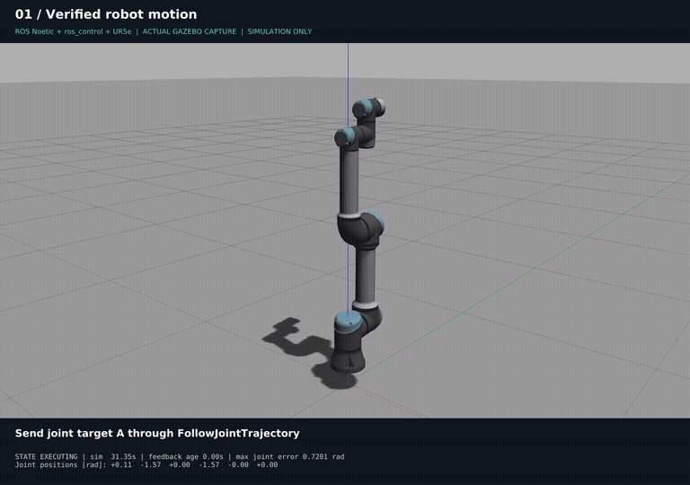
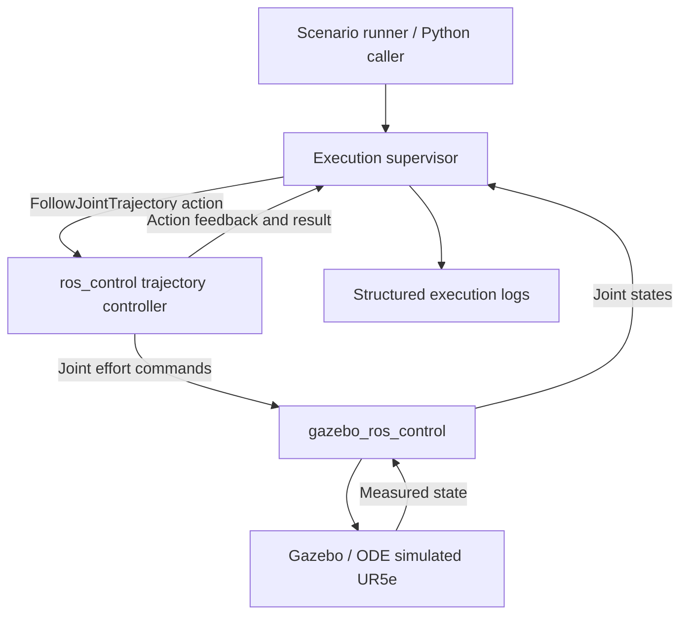

# UR5e Control & Recovery

**Robot control, execution monitoring, and fault recovery with ROS 1 and Gazebo.**

A simulation-only robotics integration capstone built around a UR5e arm. Commands
travel through an existing ROS trajectory controller into Gazebo physics, and
completion is checked against measured robot state. The project demonstrates
asynchronous execution, command replacement, failure detection, explicit recovery,
and reproducible integration tests.

**Verified:** 8 integration tests passing · Headless and graphical simulation · No physical hardware or paid services

## Demo

[](artifacts/demo-clips/00-full-demo.mp4)

**[Watch the complete demonstration — 44 seconds](artifacts/demo-clips/00-full-demo.mp4)**

| Clip | What to look for | Duration |
| --- | --- | --- |
| [Verified robot motion](artifacts/demo-clips/01-verified-motion.mp4) | Three joint targets, timed execution, and measured completion | 19 s |
| [Command replacement](artifacts/demo-clips/02-command-replacement.mp4) | Cancel an active goal and independently complete its replacement | 11 s |
| [Fault detection and recovery](artifacts/demo-clips/03-fault-and-recovery.mp4) | Detect stale feedback, reject new commands, recover explicitly, and execute fresh intent | 15 s |

The MP4s contain actual, continuous Gazebo window captures with captions and telemetry
from the execution run. Playback is not sped up. The GIF is a shorter preview; click
it to open the complete video. Clips are silent and captioned.

In the fault clip, feedback is deliberately interrupted **at the supervisor's
consumer**, while physics continues. Displayed joint values remain at the last
received sample as the feedback-age counter increases. This exercises the watchdog;
it does not claim to reproduce a physical network failure.

## Capabilities

- **Robot-control integration:** send `FollowJointTrajectory` actions and receive controller feedback and results.
- **Observed execution:** check joint position, velocity, freshness, and settling instead of trusting acknowledgement alone.
- **Asynchronous commands:** return Futures and coordinate cancellation and replacement with distinct command IDs.
- **Timing and liveness:** use simulation time for motion and monotonic wall time for watchdogs and deadlines.
- **Fault recovery:** latch failures, block new commands, request cancellation, and require explicit recovery.
- **Traceability:** correlate commands, controller feedback, observed state, and terminal outcomes in structured logs.

## Architecture



### Reuse and project contributions

| Component | Provided by |
| --- | --- |
| UR5e model, meshes, inertial properties, limits, and controller gains | Upstream `ur_description` and `ur_gazebo` |
| Trajectory interpolation, effort control, and action-server behavior | Existing `ros_control` trajectory controller |
| Physics and simulated hardware interface | Gazebo Classic, ODE, and `gazebo_ros_control` |
| Validation, Futures, replacement coordination, watchdogs, and recovery policy | This project's [execution supervisor](src/robot_control/execution.py) |
| Startup sequencing, scenario assertions, evidence collection, and recordings | This project's [scripts](scripts/) and [integration tests](tests/integration.py) |

Upstream robot packages and controller implementations are used without patches.
No custom physics engine, servo controller, motion planner, or middleware is introduced.

## Verified results

The recorded run on **2026-11-15** passed the baseline and all eight integration tests
with the graphical client running. Across the three baseline moves, maximum final
joint error was approximately **0.00013 rad**, against a **0.03 rad** threshold.
This describes the tested scenarios, not a general robot-accuracy claim.

| Integration scenario | Verified behavior |
| --- | --- |
| Normal execution | Successful action, settled measured joints, and direct Gazebo confirmation |
| Invalid or stale commands | Reject wrong dimensions, non-finite values, limit violations, and expired intent before dispatch |
| Cancellation and replacement | Acknowledge cancellation and independently complete the replacement |
| Feedback loss | Detect stale state, latch a fault, recover explicitly, and complete a fresh command |
| Paused physics | Detect loss of advancing feedback using wall time |
| Controller deactivation | Detect failure and reject recovery while the controller remains stopped |
| Inconsistent observations | Detect a target mismatch despite a successful controller result |
| Execution deadline | Detect the wall-time deadline and request cancellation |

Baseline motion requires fresh, finite feedback; position error at most 0.03 rad;
speed at most 0.05 rad/s for 0.25 simulation seconds; actual displacement; and advancing
physics time. Direct Gazebo joint queries additionally confirm target positions.

Saved evidence:

- [Baseline measurements and trace](artifacts/milestone1.json)
- [Regression summary](artifacts/regression-summary.json) and [scenario outcomes](artifacts/regression-results.json)
- [Command, feedback, and outcome logs](artifacts/execution-events.jsonl)
- [Video evidence and decoding checks](artifacts/demo-clips/README.md)
- [Verification report](docs/verification.md)

All four exported MP4s were fully decoded without errors. Representative frames were
visually checked for robot motion, framing, and readable captions.

## Requirements and setup

### Validated environment

| Dependency | Configuration |
| --- | --- |
| Operating system | Ubuntu 20.04, x86-64 |
| ROS | ROS 1 Noetic at `/opt/ros/noetic` |
| Simulator | Gazebo Classic 11.15.1, ODE physics |
| Python | System Python 3.8 through `/usr/bin/python3` |
| Robot packages | `ur_description` / `ur_gazebo` 1.5.0 |
| Additional controllers | `joint_trajectory_controller` / `effort_controllers` 0.22.0 |
| Optional recording tools | ffmpeg, ffprobe, xdotool, xwininfo, and an X11 display |

Setup expects an existing Noetic/Gazebo installation with `gazebo_ros`,
`gazebo_ros_control`, `controller_manager`, `joint_state_controller`,
`position_controllers`, `robot_state_publisher`, `actionlib`, and their message packages.
It does not provision a fresh operating system or complete ROS installation.

From the repository root:

```bash
# Download and extract four pinned packages into this workspace.
/usr/bin/python3 scripts/bootstrap.py

# Activate system ROS and the project-local overlay.
source scripts/env.sh
```

Bootstrap verifies pinned SHA-256 checksums and extracts packages under `.deps/`.
It downloads approximately 21 MB and uses approximately 92 MB including archives.
It requires access to the ROS package server, does not require sudo, and does not
modify system packages or existing Conda environments. It targets the configuration above.

Source `scripts/env.sh` in each project terminal. It selects ROS master port **11321**
and Gazebo master port **11355**, and keeps logs local. Use `/usr/bin/python3`
explicitly to avoid selecting an incompatible Conda or pyenv interpreter.

## Run

### Baseline simulation

```bash
source scripts/env.sh
/usr/bin/python3 scripts/run_milestone1.py
```

The runner starts Gazebo paused, configures the initial pose, loads controllers,
starts physics, verifies three motions, and shuts down its own process group.
Failed checks return a nonzero exit code; occupied master ports are rejected.
The launch console is saved to `.runtime/launch.log`.

### Execution and recovery demonstration

```bash
/usr/bin/python3 scripts/run_milestone1.py --demo

# Optional: show the GUI and leave it open afterward.
/usr/bin/python3 scripts/run_milestone1.py --demo --gui --keep-running
```

Use Ctrl-C to stop a simulation left open with `--keep-running`.

### Integration tests

```bash
/usr/bin/python3 scripts/run_milestone1.py --regression
```

The suite uses standard-library `unittest` and real Gazebo/controller interfaces.
Physics pause and controller deactivation use real services; feedback loss and
corruption use explicit injection points in the consumer. Each suite invocation
starts a fresh world. Scenarios run in a fixed order, restoring feedback, physics,
controller state, and settling between tests.

### Record the demo clips

```bash
/usr/bin/python3 scripts/run_milestone1.py --regression --record-clips
```

Recording additionally requires the graphical tools above. It captures only the
Gazebo window, adds captions from timestamped execution data, exports the three
chapters and combined MP4, and verifies decoding. Exports and evidence are in
`artifacts/demo-clips/`; source recordings stay in `.runtime/recordings/`.

Verification JSON files are replaced by subsequent runs; execution event logs append.
The runner retains its original `run_milestone1.py` name because the baseline remains
the first gate before tests, demonstrations, or recording.

## Engineering decisions

**Sequence initialization before controller execution.** The original concurrent
bringup activated controllers before the spawn utility applied the initial pose.
The project configures the robot while paused, loads controllers, then unpauses
physics to complete activation. Measured initial state is checked before motion.

**Retain effort-driven simulation.** A position-interface fallback showed inconsistent
position/velocity behavior during settling. The final setup retains upstream effort
gains and uses a **100 µs physics timestep**, which passed repeated checks. The default
1 ms step failed goal checks in this setup. This is an empirical configuration choice,
not a complete stability analysis or a hard real-time guarantee.

**Make recovery explicit.** A fault blocks new intent. Recovery requires a running
controller and fresh, settled state; it does not replay the old command. Cancellation
acknowledgement is an action-protocol result, not proof of a physical stop.

Failed baseline traces are preserved. Read the [startup and timestep investigation](docs/milestone1.md)
and [execution architecture and fault policy](docs/execution.md).

## Repository map

```text
src/robot_control/execution.py     Execution supervisor and joint observer
launch/simulation.launch         Existing ROS/Gazebo component composition
worlds/control.world             Physics configuration and demo camera
scripts/bootstrap.py             Pinned dependency overlay
scripts/env.sh                   Project environment and master ports
scripts/initialize_simulation.py  Sequenced robot/controller startup
scripts/verify_motion.py          Baseline measured-motion checks
scripts/run_milestone1.py         Lifecycle, baseline, tests, and demo runner
scripts/demo.py                   Narrated execution/recovery scenario
scripts/record_clips.py           Window capture and measured-data captions
scripts/finalize_clips.py         Combined demo and decoding checks
tests/integration.py              Eight simulator-backed regression scenarios
artifacts/                       Measurements, logs, experiments, and videos
docs/                            Architecture, decisions, and verification
```

## Scope and limitations

- **Simulation only:** no physical robot, calibrated dynamics, hardware-in-the-loop testing, real fieldbus validation, or certified physical safety.
- **Bounded integration prototype:** no collision-aware planner, perception, AI policy, Cartesian interface, or production SDK. Competing external clients and all cancellation/completion races are not comprehensively tested.
- **Legacy dependencies:** Noetic and Gazebo Classic reuse the existing environment. Versions are pinned; ROS 2 migration is a separate exercise.
- **Known environment warnings:** Gazebo can emit `libcurl` compatibility warnings, and ROS can emit XML-RPC socket `ResourceWarning`s. Verified runs passed; global libraries are not patched to hide warnings.

## Upstream projects

Built on [ROS-Industrial Universal Robots](https://github.com/ros-industrial/universal_robot),
[ros_control](https://github.com/ros-controls/ros_control),
[ros_controllers](https://github.com/ros-controls/ros_controllers), and
[gazebo_ros_pkgs](https://github.com/ros-simulation/gazebo_ros_pkgs).
Upstream license notices remain in the extracted packages.
